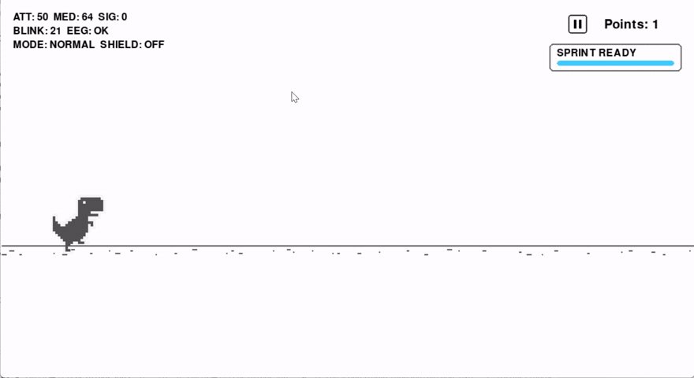
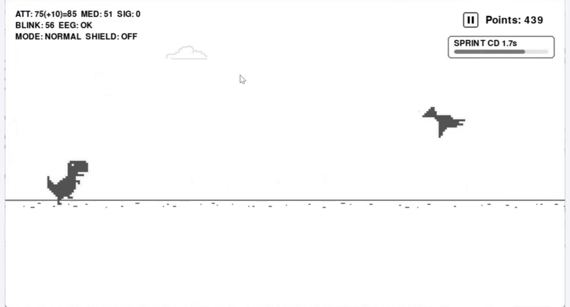
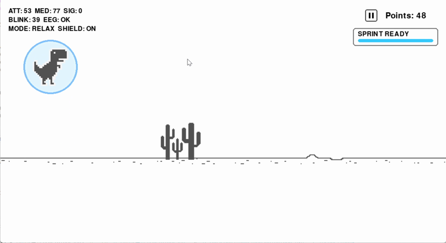
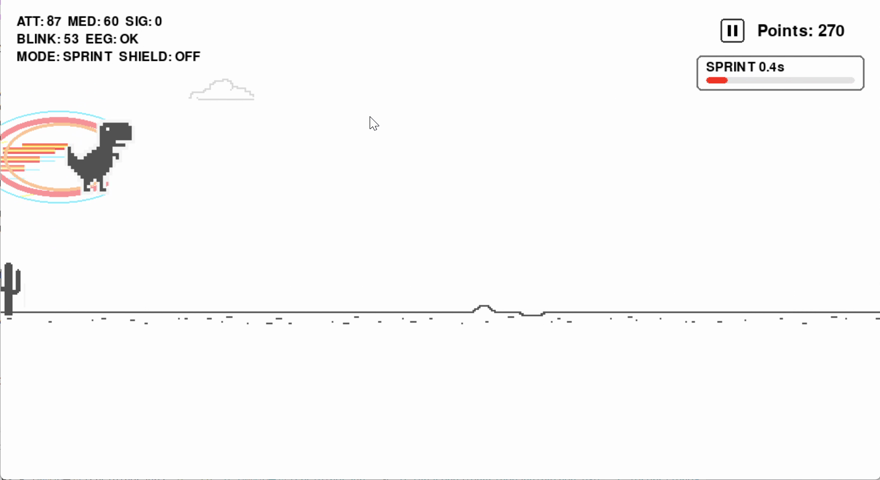
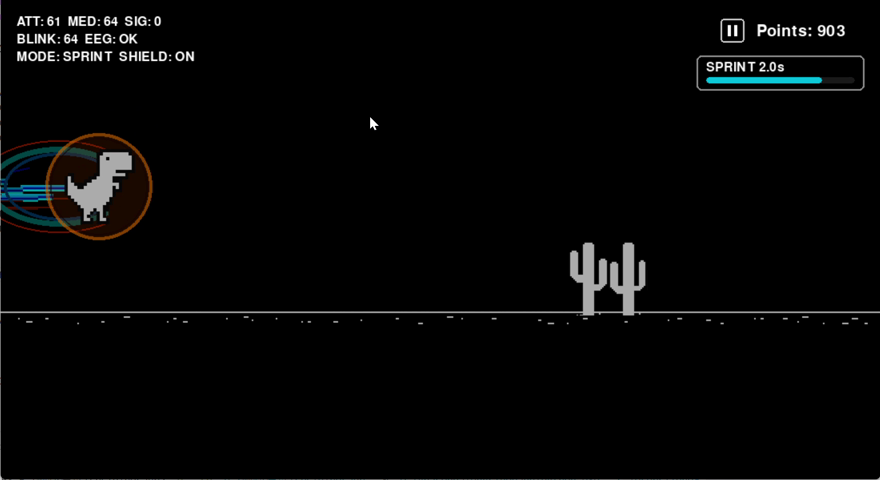
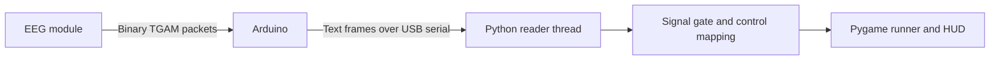
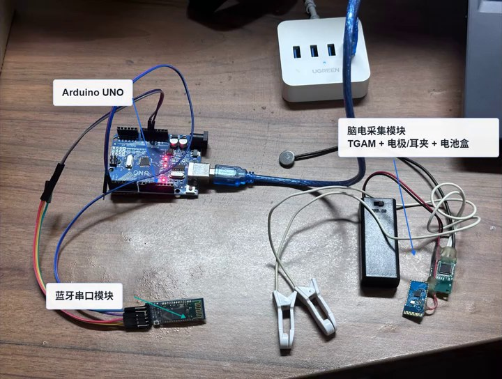

<div align="center">

# EEG Dinosaur Runner

**Blink to jump. Relax to shield. Focus to sprint.**

An EEG-controlled dinosaur runner built with **Arduino, NeuroSky TGAM and Python/Pygame**.


[Watch the demo](#demo) · [Play without hardware](#quick-start) · [Build the EEG setup](#hardware) · [How it works](#how-it-works)

</div>

Bring EEG and blink input into a familiar endless runner. A TGAM-compatible module supplies brain-state indicators and raw samples; an Arduino turns them into compact serial messages, and a Pygame game responds with jumps, protective shields and short bursts of speed.

Built as a hardware course project, the system connects signal acquisition, embedded packet parsing and live visual feedback in one playable prototype. The desktop game also supports keyboard controls and a software simulator, so its interaction mechanics can be explored without the headset.

**No headset? You can still try it.** The command-line launcher starts in keyboard mode, or generates synthetic EEG input for a hardware-free demonstration. Only real EEG mode needs an Arduino and acquisition module.

## Demo

[](https://github.com/Rocky-Bai-hust/EEG-dinosaur-runner/raw/refs/heads/main/media/demo.mp4)

**[Watch or download the 25-second demo](https://github.com/Rocky-Bai-hust/EEG-dinosaur-runner/raw/refs/heads/main/media/demo.mp4)** — jumping, relaxation shield, focus sprint and night mode. The preview above is a shorter looping excerpt.

The images below come from the project report and supplied screen recording. They show the interface and game states; keyboard inputs and demonstration assists may be active in the recording.

<table>
  <tr>
    <td align="center"><br><b>Live feedback</b><br>Signal quality, blink count and game status</td>
    <td align="center"><br><b>Relaxation shield</b><br>A blue shield absorbs one collision</td>
  </tr>
  <tr>
    <td align="center"><br><b>Focus sprint</b><br>A brief speed boost with collision immunity</td>
    <td align="center"><br><b>Night mode</b><br>Score-based day and night switching</td>
  </tr>
</table>

## What you can do

- **Blink to jump.** The Arduino detects candidate blink events from raw-signal amplitude; the desktop consumes each pending event once.
- **Relax to protect the dinosaur.** A meditation indicator of 65 or above slows the game to 75% speed and enables a shield, with an 8-second cooldown after use.
- **Focus to sprint.** Effective attention of 80 or above triggers a 2.5-second sprint, followed by a 7-second cooldown.
- **Watch the input as you play.** The HUD displays attention, meditation, signal quality, blink count, connection state and active abilities.
- **Switch to keyboard or simulation.** Jump, duck, pause and restart while developing or demonstrating the game without EEG hardware.

## How it works



The hardware and desktop handle different parts of the pipeline. The Arduino synchronizes and checks TGAM packets, extracts the module's indicators and turns raw-amplitude crossings into blink candidates. A background Python thread reads the resulting messages, allowing the Pygame loop to update without waiting for serial input.

The game uses a snapshot of the latest state each frame. Good signal enables EEG controls; blink is handled as an event, while attention and meditation control abilities with cooldowns. This separation also makes it possible to test the desktop mechanics with simulated input.

## Quick start

### 1. Install the desktop game

Use **Python 3.9+** and a graphical desktop. Windows was used for the original hardware demonstration.

```bash
git clone https://github.com/Rocky-Bai-hust/EEG-dinosaur-runner.git
cd EEG-dinosaur-runner
python -m venv .venv
```

Activate the environment:

```powershell
# Windows PowerShell
.venv\Scripts\Activate.ps1
```

```bash
# Linux / macOS
source .venv/bin/activate
```

Install the dependencies:

```bash
python -m pip install -r requirements.txt
```

### 2. Play — no configuration edits required

**Keyboard only** — no Arduino, headset or serial port needed:

```bash
python play.py
```

Press any key at the menu, then use **Space / Up** to jump and **Down** to duck. This mode disables automatic jumping and the classroom jump/focus assists.

**Simulated EEG** — explore the indicators, shields and sprints with generated input:

```bash
python play.py --simulate
```

The simulator opens no serial port. It demonstrates the software interaction pipeline; it does not measure a person's brain activity.

**Real EEG** — connect the [hardware](#hardware), then supply the actual Arduino port:

```bash
python play.py --eeg --port COM7
```

On Linux or macOS, replace `COM7` with the appropriate device path. The firmware and desktop use **57600 baud**. The default connection screen waits for **SIG=0 for 2 seconds** before starting.

Run `python play.py --help` to see the options. Advanced thresholds remain in `dinosaur/config.py`; the launcher applies mode settings in memory and leaves that file unchanged. The original `python dinosaur/main.py` entry point remains available and uses its saved configuration.

| Control | Action |
| --- | --- |
| Up arrow / Space | Jump |
| Down arrow | Duck |
| Q / on-screen pause button | Pause or resume |
| R while paused | Restart |
| Escape on the connection screen | Return to the menu |

## Hardware



*The project assembly: Arduino UNO, TGAM-compatible acquisition module, electrodes, battery box and a Bluetooth serial module. The original report labels are retained in the photo.*

The supplied firmware documents a **wired UART-to-USB reference setup**. Use a TGAM-compatible module, an Arduino UNO or compatible Nano, a USB data cable and connection wires. The report also describes an HC-05 transparent transport; Bluetooth pairing and configuration are not included in the sketch.

| Connection | Destination |
| --- | --- |
| Module TX | Arduino D0/RX |
| Module GND | Arduino GND |
| Module RX | Leave disconnected |
| Arduino USB | Computer |

Verify the particular module's power and UART logic requirements before wiring.

1. **Disconnect the module TX wire from D0/RX before uploading.** This pin is also used by the bootloader.
2. Open `arduino/arduino.ino` in Arduino IDE, select the actual board and port, and upload.
3. Reconnect the module TX wire. Close the serial monitor before starting Python.
4. Launch with `python play.py --eeg --port COM7`, replacing the port with your actual device.

Both sides use **57600 baud**. During gameplay the desktop accepts EEG input at SIG <= 10; firmware blink detection uses SIG <= 50 and requires a valid digest with positive attention or meditation.

<details>
<summary><b>Serial message format</b></summary>

Each Arduino message ends with a newline:

```text
ATT:65,MED:48,SIG:0,BLINK:1,COUNT:3
```

| Field | Meaning |
| --- | --- |
| `ATT` | Module attention indicator, typically 0–100 |
| `MED` | Module meditation indicator, typically 0–100 |
| `SIG` | Poor-signal indicator; lower is better |
| `BLINK` | 1 latches a jump candidate |
| `COUNT` | Cumulative blink-candidate count |

The firmware recognizes fixed 4-byte raw and 32-byte digest payloads. Blink detection uses an absolute amplitude threshold of 1050 and a 350 ms refractory interval.

</details>

## Project structure

```text
play.py                        Keyboard / simulator / real-EEG launcher
arduino/arduino.ino             TGAM parser and blink-event forwarding
dinosaur/main.py               Game loop, abilities and HUD
dinosaur/config.py             Serial settings and control thresholds
dinosaur/eeg_serial_reader.py   Background reader and simulator
dinosaur/eeg_control.py         Signal gate and speed helpers
dinosaur/Assets/               Game sprites
media/                         Report images and edited demo excerpts
requirements.txt               Desktop dependencies
```

## Configuration notes

The supplied settings favor classroom demonstrations. Adaptive jump clearance, bad-signal automatic jumping and an earned effective-attention bonus are enabled by default. For unassisted evaluations, disable `ENABLE_MIN_JUMP_CLEARANCE`, `IN_GAME_BAD_SIGNAL_AUTOPILOT` and `ENABLE_FOCUS_SUCCESS_ASSIST`, and record any keyboard input.

Attention and meditation are indicators provided by the module. Blink detection is an amplitude heuristic that can react to artifacts. Ordinary attention speed tiers are disabled in the supplied code; attention changes speed through sprint activation. The reader has no inactivity timeout or automatic reconnect, so restart the application after restoring a lost connection.

If the connection screen stays open, check the port, baud rate and SIG, and close other serial applications. To find the port, run `python -m serial.tools.list_ports`.

## Help improve the project

Reproduction feedback is especially useful: [open an issue](https://github.com/Rocky-Bai-hust/EEG-dinosaur-runner/issues/new) with your operating system, Python version, input mode and the exact error. For hardware reports, include the board/module model and signal indicator, and remove personal information from logs.

Useful contributions include testing the setup on other operating systems, documenting compatible TGAM modules, and improving connection recovery. Pull requests are welcome. If this project helps your learning or prototyping, a Star makes it easier to find again.

## Citation

When citing this project, include its title, [repository URL](https://github.com/Rocky-Bai-hust/EEG-dinosaur-runner) and the exact commit used. For reproducible experiments, also record software versions, hardware model, thresholds and assist settings. This educational prototype does not include a participant dataset or a quantitative performance benchmark.

## Credits and license

The [MIT license](LICENSE) covers the listed original components, including the Arduino firmware, EEG modules and launcher. The game code and artwork described below are excluded from that grant.

The game is derived from [MaxRohowsky/chrome-dinosaur](https://github.com/MaxRohowsky/chrome-dinosaur).

`dinosaur/main.py` and `dinosaur/Assets/` contain upstream-derived code and sprites. No explicit upstream license was found during preparation. These files are excluded from this repository's MIT grant; attribution does not grant redistribution or reuse rights. Obtain upstream permission or replace them before claiming a fully permissively licensed distribution.

Pygame, pyserial and Arduino board cores are installed separately and retain their own licenses.

Gameplay screenshots, animations and video clips in `media/` depict the same upstream-derived artwork and do not grant additional rights to it. The hardware photograph is taken from the project's own report.
