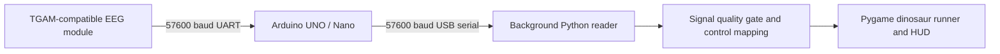

# EEG Dinosaur Runner

An Arduino-based EEG interaction prototype for a Python/Pygame dinosaur runner. A TGAM-compatible module supplies signal quality, attention and meditation indicators; the Arduino validates binary packets, detects blink candidates from raw-signal amplitude, and forwards compact text frames to the desktop game.

This repository accompanies an educational hardware project. It contains the implementation and a reproducibility guide, without participant recordings or identifying course documents. No associated peer-reviewed publication, quantitative benchmark or clinical validation is claimed.

## System overview



The supplied sketch implements the wired UART-to-USB route. The course report also describes an HC-05 transparent Bluetooth transport; pairing commands and a complete Bluetooth wiring diagram are not included in this release.

## Features and actual control behavior

| Input / state | Implemented behavior |
| --- | --- |
| Blink candidate | One jump event, accepted when the desktop signal gate passes |
| Effective attention >= 80 | 2.5-second sprint, +8 speed units and collision immunity; 7-second cooldown after completion |
| Meditation >= 65 | Speed multiplier of 0.75 and a shield absorbing one collision; 8-second shield cooldown |
| Poor signal / disconnected reader | EEG-triggered actions are gated; the supplied demo configuration can automatically jump nearby ground obstacles and low birds |
| Keyboard | Jump, duck, pause/resume and restart |
| HUD | Attention, meditation, signal quality, blink count, connection state, mode, shield and sprint state |

The supplied `attention_speed_bonus()` currently returns **zero for every attention level**. Attention affects sprint triggering; the old tiered +2/+4/+6 speed description is not implemented. Base speed increases with score and is clamped to 5–30 units per frame. Attention and meditation are module-provided indicators, not estimators trained or validated by this project. Blink detection is an amplitude heuristic and may respond to artifacts.

## Repository layout

```text
arduino/arduino.ino       TGAM packet parser and blink-event forwarding
dinosaur/main.py         Pygame game loop and visual feedback
dinosaur/config.py       Serial configuration, thresholds and demo flags
dinosaur/eeg_serial_reader.py  Background reader and simulator
dinosaur/eeg_control.py   Signal gate and speed helpers
dinosaur/Assets/          Third-party game sprites (see notices)
docs/hardware.md          Wiring and firmware upload instructions
docs/protocol.md          Packet and desktop frame details
docs/reproducibility.md   Reproduction procedure and limitations
examples/serial_frames.txt  Synthetic protocol examples
tests/                   Hardware-independent checks
LICENSE                  MIT terms for the explicitly listed original files
THIRD_PARTY_NOTICES.md    Attribution and unresolved upstream licensing
CITATION.cff             Software citation metadata
```

## Installation

Use Python 3.9 or later and a graphical desktop. Windows is the original project environment; other platforms have not been tested with the hardware. Arduino IDE 2.x and an AVR UNO/Nano-compatible board are required for firmware upload. The sketch uses the Arduino core only.

```bash
git clone https://github.com/Rocky-Bai-hust/EEG-dinosaur-runner.git
cd EEG-dinosaur-runner
python -m venv .venv
```

Activate the environment on Windows PowerShell:

```powershell
.venv\Scripts\Activate.ps1
```

Or on Linux/macOS:

```bash
source .venv/bin/activate
```

Then install dependencies:

```bash
python -m pip install -r requirements.txt
```

The dependency ranges specify compatible APIs; they are not a lockfile for the historical course environment. Record your resolved versions when reporting experiments.

## Run without EEG hardware

For keyboard-only operation, edit **your cloned copy** of `dinosaur/config.py`:

```python
SERIAL_ENABLED = False
IN_GAME_BAD_SIGNAL_AUTOPILOT = False
```

Disabling serial bypasses the startup gate. Disabling autopilot ensures jumps come from keyboard input.

For simulated EEG instead:

```python
SERIAL_ENABLED = True
SIMULATE_EEG = True
```

The simulator supplies random ATT/MED values, SIG=0 and periodic blink candidates; it is intended for functional demonstrations, not performance measurement. Start the game from the repository root:

```bash
python dinosaur/main.py
```

Press any key at the menu. Up arrow or Space jumps; Down arrow ducks; Q or the on-screen pause button pauses/resumes; R restarts while paused. Escape returns from the connection screen to the menu. Close the window to exit.

## Run with Arduino and EEG hardware

1. Follow [hardware setup](docs/hardware.md), including the D0/RX upload precaution.
2. Open `arduino/arduino.ino` in Arduino IDE, select the actual board and port, and upload.
3. Reconnect the module data wire and close the IDE serial monitor so Python can open the port.
4. Set `SERIAL_ENABLED = True`, `SIMULATE_EEG = False`, `SERIAL_PORT` to your device port, and `SERIAL_BAUD = 57600` in `dinosaur/config.py`. `COM7` is an example inherited from the course setup, not a universal port.
5. Run `python dinosaur/main.py` and press a key. The default startup gate requires a connected reader and SIG=0 for 2000 ms before a run begins.

During gameplay, the desktop signal gate accepts SIG <= 10. The firmware blink gate accepts SIG <= 50 and requires at least one positive attention/meditation indicator. These are different thresholds in the supplied implementation; see [protocol details](docs/protocol.md).

## Reproduction and validation

```bash
python -m unittest discover -s tests -v
python -m compileall -q dinosaur tests
```

The automated checks cover text parsing, one-shot blink consumption, state snapshots, signal thresholds and speed bounds. They do not establish hardware reliability or scientific validity. [Reproducibility notes](docs/reproducibility.md) describe a manual end-to-end checklist and the demo assists that must be controlled before collecting results.

## Troubleshooting

- **Connecting EEG Device does not finish:** check the port, baud rate, module connection and SIG=0. For a hardware-free run use one of the explicit modes above; the default configuration deliberately waits for hardware.
- **Port cannot be opened:** close other serial applications, verify the USB driver and list ports with `python -m serial.tools.list_ports`.
- **Unexpected jumps:** disable `IN_GAME_BAD_SIGNAL_AUTOPILOT`, check signal quality and tune firmware blink thresholds for your module. Simulator and optional EEG test hotkeys also introduce synthetic input.
- **EEG stops updating:** the reader has no inactivity timeout or automatic reconnect. Silent links may retain old values. Restart the application after correcting the connection.
- **Different packet layout:** the firmware handles two fixed TGAM payload layouts, not every possible ThinkGear data record.

## Research scope and data availability

No raw EEG dataset, participant identifiers, images of participants, personal contact details, enrollment records or course submissions are distributed. The example frames are synthetic. Quantitative accuracy, latency, false-positive rate and participant-study outcomes are not available in this release. Report hardware, module firmware, software versions, thresholds and assistance flags alongside any future measurements.

## Citation

Use the repository's `CITATION.cff` / GitHub “Cite this repository” metadata and include the exact commit used. The citation identifies the contributor group without publishing individual names. This is software metadata, not a fabricated paper citation or DOI.

## Attribution and license scope

The game derives from [MaxRohowsky/chrome-dinosaur](https://github.com/MaxRohowsky/chrome-dinosaur). Public upstream attribution is retained in [third-party notices](THIRD_PARTY_NOTICES.md). An explicit upstream license was not found in the supplied archive or the upstream root during preparation.

The MIT license covers only the original files listed in [LICENSE](LICENSE). It does **not** relicense `dinosaur/main.py` or `dinosaur/Assets/`. Those portions are provided with their provenance and unresolved licensing status; a fully permissively licensed distribution requires upstream permission or replacement. Do not interpret this repository as granting rights to all third-party material.

Contributions should include reproducible evidence and avoid personal data; see [CONTRIBUTING.md](CONTRIBUTING.md).
